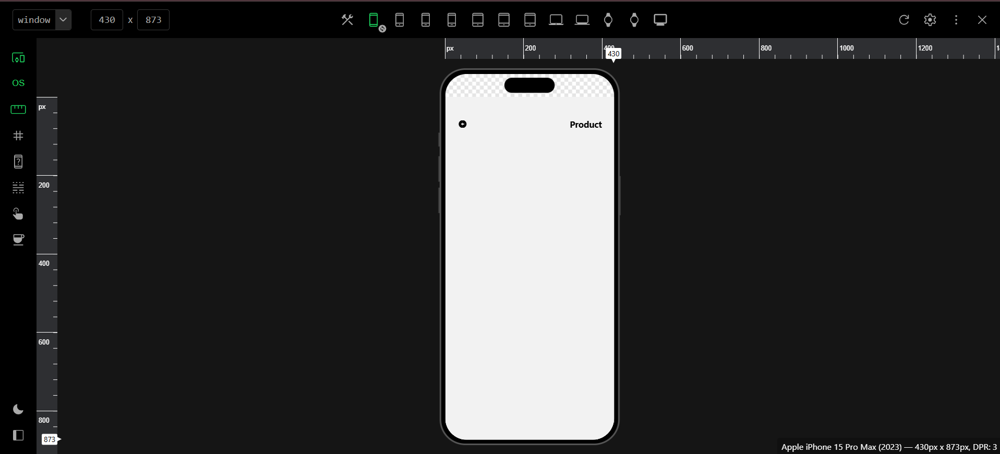
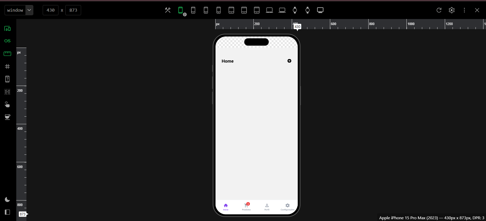
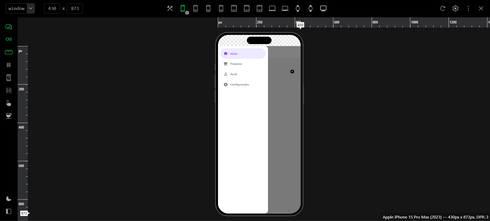

# my-app

**Aluno:** RUIMAR CLETO DE ALBUQUERQUE SILVANO

App em **React Native (Expo)** que mostra os três tipos de navegação do **React Navigation** — **Stack**, **Bottom Tabs** e **Drawer** — usando as mesmas telas. Projeto do Ciclo Avaliativo 1 de Dispositivos Móveis.

## Os três tipos de navegação

| Tipo | Como funciona | Neste app |
|---|---|---|
| **Stack** | Empilha telas, uma por cima da outra, como uma pilha de cartas. | Home → Product. O botão `+` da Home abre a tela Product; a seta (ou o botão voltar do Android) retorna. |
| **Bottom Tabs** | Telas lado a lado, acessadas por uma barra fixa na parte de baixo. | 4 abas: Início, Produtos (com o balãozinho vermelho "3"), Perfil (ícone vazado/preenchido conforme a aba ativa) e Configurações. |
| **Drawer** | Painel que desliza a partir da lateral da tela. | Menu lateral com 4 itens (Início, Produtos, Perfil e Configurações) e o item ativo destacado. Abre pelo botão ☰ do cabeçalho e arrastando o dedo a partir da borda esquerda. |

O código das **telas** (`src/screens`) não muda quando o tipo de navegação muda: a tela sempre chama `navigation.navigate("product")`, e quem decide se isso empilha uma tela, troca de aba ou troca o item do menu é o **navegador**, configurado na pasta `src/routes`.

### Como trocar o tipo de navegação

Em `src/routes/index.jsx`, altere **uma única linha** e salve (o Fast Refresh do Expo recarrega o app sozinho):

```js
const TIPO_DE_NAVEGACAO = "stack";   // pilha
const TIPO_DE_NAVEGACAO = "bottom";  // abas inferiores
const TIPO_DE_NAVEGACAO = "drawer";  // menu lateral
const TIPO_DE_NAVEGACAO = "aninhado"; // Drawer → Bottom Tabs → Stack (desafio opcional)
```

## Desafio opcional: modo `"aninhado"`

Para ativar, em `src/routes/index.jsx` troque a constante para:

```js
const TIPO_DE_NAVEGACAO = "aninhado";
```

Os três navegadores passam a conviver, um dentro do outro (Passo 9 do PDF):

```text
Drawer            (menu lateral, com o item "tabs")
└── Bottom Tabs   (Início, Produtos, Perfil e Configurações)
    └── Stack     (home → product, dentro da aba Início)
```

- **Onde está cada peça:** `DrawerAninhadoRoutes` (em `DrawerRoutes.jsx`) registra `<Drawer.Screen name="tabs" />`; `BottomAninhadoRoutes` (em `BottomRoutes.jsx`) registra `<Bottom.Screen name="homeStack" />` com o `StackRoutes` dentro. Os modos `stack`, `bottom` e `drawer` continuam iguais.
- **Sem cabeçalhos duplicados:** só o Drawer mostra o cabeçalho (com o botão ☰). Bottom Tabs e Stack ficam com `headerShown: false`.
- **`navigate` entre navegadores:** quando a rota de destino está em outro navegador, usa-se o caminho completo: `navigation.navigate("tabs", { screen: "product" })`. A Home continua chamando `navigation.navigate("product")`, porque o `product` está no mesmo Stack dela.

## Como rodar

```bash
npm install
npx expo start
```

Para abrir direto em uma plataforma: `npm run android`, `npm run ios` ou `npm run web`.

Se aparecer algum erro estranho depois de instalar bibliotecas nativas, limpe o cache do bundler com `npx expo start --clear`.

## Estrutura do projeto

```text
my-app/
├── index.js
├── package.json
├── README.md
├── prints/             # prints dos modos (Stack, Bottom Tabs e Drawer)
└── src/
    ├── App.jsx            # GestureHandlerRootView envolvendo o app
    ├── assets/
    ├── components/        # ButtonIcon, Header, Title
    ├── routes/            # toda a navegação
    │   ├── index.jsx      # NavigationContainer + TIPO_DE_NAVEGACAO
    │   ├── StackRoutes.jsx
    │   ├── BottomRoutes.jsx
    │   └── DrawerRoutes.jsx
    └── screens/           # as telas do app
        ├── Home.jsx
        ├── Product.jsx
        ├── Profile.jsx
        └── Settings.jsx
```

## Prints

### Stack


### Bottom Tabs (4 abas e balãozinho)


### Drawer aberto

